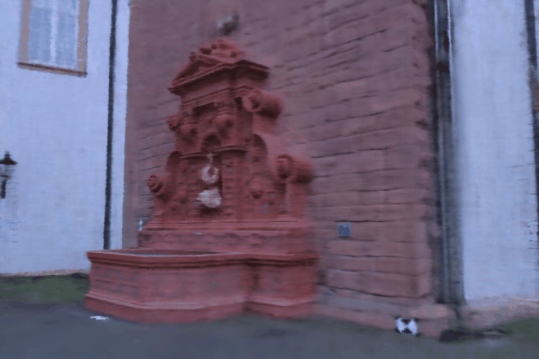

# NeRF Results Analysis — `images` Scene



## Dataset
- **Source:** [3D Object Reconstruction from Images (Kaggle)](https://www.kaggle.com/datasets/kpoviesistphane/3d-object-reconstruction-from-images)
- **Scene:** `data/archive/images` (11 input views at `3072×2048`)
- **COLMAP SfM (`data/processed/images`):**
  - Registered images: `11 / 11`
  - Camera model: `SIMPLE_RADIAL` (per-image cameras with radial distortion)
  - Sparse 3D points: `5,694`
  - Mean reprojection error: `0.5637 px`

## How It Was Run

### 1. Training
Trained coarse and fine NeRF MLPs (`Lx=10`, `Ld=4`, `64` coarse + `128` fine importance samples per ray) on all 11 images using scene normalization, automatic `near`/`far` estimation, radial undistortion, and exponential learning-rate decay (`5e-4` → `5e-5`) on an **NVIDIA GeForce RTX 3050 6GB Laptop GPU**:

```bash
uv run python main.py \
  --scene images \
  --val-ratio 0.0 \
  --epochs 3000 \
  --save-every-epochs 100 \
  --checkpoint-dir outputs/images_nerf
```

### 2. Trajectory Rendering
Rendered 81 frames (`10` consecutive camera pairs × `8` steps + `1` final frame) at `1/4` resolution (`768×512`) using SO(3) geodesic pose interpolation in **FP32** (~`140.7 s/frame`):

```bash
uv run python -m src.nerf.visualizer \
  --scene images \
  --checkpoint outputs/images_nerf/latest.pt \
  --output results/nerf_images_dataset_kaggle/render.gif \
  --steps-per-pair 8 \
  --render-scale 0.25 \
  --ray-chunk 32768 \
  --no-fp16
```

*(Note: A subsequent benchmark with CUDA FP16 autocast achieved a **2.13× inference speedup** — `65.93 s/frame` vs. `140.70 s/frame` in FP32 — but since this FP32 render was already running, it was left to finish without re-running.)*

## Issues Resolved During Setup
- **Dead ReLU on `sigma_head`:** Initially, `ReLU` on the density head clamped negative initial predictions to `0.0`, producing zero gradients and stalling the loss at `~0.4096`. Replacing `ReLU` with `Softplus` (and initializing the `sigma_head` bias to `-2.0`) fixed gradient flow immediately.
- **Coordinate convention & scene bounds:** Aligned camera-space ray directions to COLMAP's OpenCV convention (`+X` right, `+Y` down, `+Z` forward), added radial undistortion, and added scene centering/scaling with automatic `near`/`far` estimation.

## Quantitative Summary
- **Epochs / Steps:** `3,000` epochs (`33,000` optimizer steps at `1,024` rays/step)
- **Train Loss (Coarse MSE + Fine MSE):**
  - Epoch 1: `0.063147`
  - Best: `0.004063`
  - Final (Epoch 3000): `0.004227`
- **Output GIF:** `render.gif` (`81` frames, `768×512`)

## Observations & Notes
- While the central structure was reconstructed well, noticeable flickering remains around the image borders, likely due to the limited number of training epochs and the sparsity of the input views (only 11 images). Introducing a spatial acceleration structure for faster, more targeted ray querying, along with denser multi-view coverage, could improve novel-view quality.
- Fine details, such as the letterbox on the left wall, exhibited similar flickering and lack of sharpness.
- Although the central structure is recognizable and coherent, it is not yet crystal clear; increasing the number of epochs and samples per ray would likely improve fidelity, though this was constrained by compute time on a consumer GPU.
- Some "floater" artifacts (translucent patches appearing in front of the structure in the rendered GIF) are present, likely stemming from insufficient training epochs and residual camera distortion or undistortion inaccuracies.
